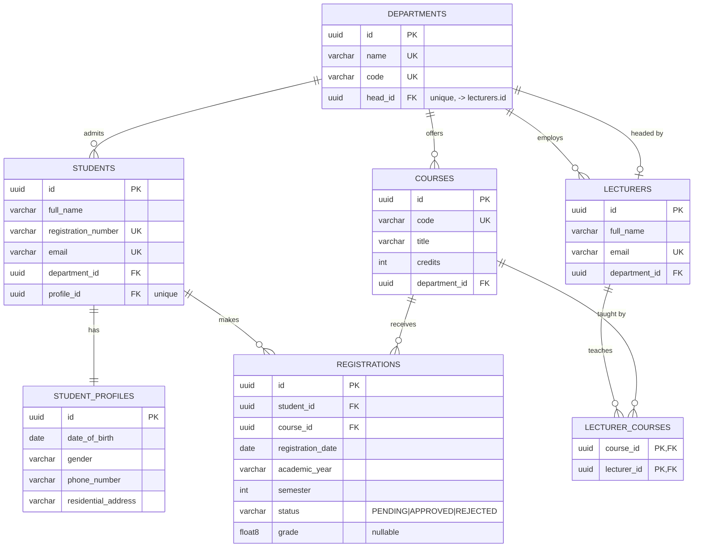

# University Course Registration and Academic Management System

**Course:** Web Technology and Internet  **Assessment:** Individual Assignment
**Stack:** Spring Boot · Spring Data JPA / Hibernate · PostgreSQL · Maven
**Scope:** Model and Repository layers only (no controllers or services yet)

| | |
|---|---|
| **Student Name** | _Mugisha Espoir_ |
| **Student Id.** | _27824_ |
| **Submission deadline** | Monday, 16 November 2026, 6:00 PM |

---


## 1. Problem Analysis

A university currently keeps its academic information manually, which makes it hard to manage student records, organise courses, assign lecturers and track registrations. The system must manage **departments, students, lecturers, courses and student course registrations**.

Key requirements extracted from the problem statement:

- A department offers many courses, employs many lecturers, admits many students, and has **exactly one lecturer as its head**.
- Each student belongs to one department and has **exactly one personal profile** (date of birth, gender, phone number, residential address). Each profile belongs to only one student.
- Each course belongs to one department.
- Lecturers can teach many courses and a course can have many lecturers. This must be maintained **without a separate entity**.
- Students can register for many courses and a course can have many students. Each registration must record the **registration date, academic year, semester, status (PENDING / APPROVED / REJECTED) and grade**.

---

## 2. Identified Entities and Attributes

| Entity | Attributes | Why it is an entity |
|---|---|---|
| **Department** | id, name, code, head (lecturer) | Core organisational unit that owns courses, lecturers and students |
| **Lecturer** | id, fullName, email, department | Has its own identity, teaches courses and may head a department |
| **Student** | id, fullName, registrationNumber, email, department, profile | Core actor of the system, admitted into a department |
| **StudentProfile** | id, dateOfBirth, gender (MALE/FEMALE/OTHER), phoneNumber, residentialAddress | Personal details; exactly one per student, so modelled as a separate 1:1 entity |
| **Course** | id, code, title, credits, department | Belongs to a department, is taught by lecturers and registered for by students |
| **Registration** | id, student, course, registrationDate, academicYear, semester, status, grade | The Student–Course relationship carries its own data, so it must be a real entity (join entity) |

**Enumerations:** `ERegistrationStatus` (PENDING, APPROVED, REJECTED) and `EGender` (MALE, FEMALE, OTHER).

---

## 3. Relationships and Cardinality

| # | Relationship | Cardinality | Implementation |
|---|---|---|---|
| 1 | Department – Student (admits) | One-to-Many | FK `students.department_id` |
| 2 | Department – Course (offers) | One-to-Many | FK `courses.department_id` |
| 3 | Department – Lecturer (employs) | One-to-Many | FK `lecturers.department_id` |
| 4 | Department – Lecturer (headed by) | One-to-One | FK `departments.head_id` (UNIQUE) |
| 5 | Student – StudentProfile (has) | One-to-One | FK `students.profile_id` (UNIQUE) |
| 6 | Lecturer – Course (teaches) | Many-to-Many | **Join table** `lecturer_courses` |
| 7 | Student – Course (registers) | Many-to-Many with attributes | **Join entity** `Registration` |

---

## 4. Foreign Keys, Join Table and Join Entity

**Relationships that require a foreign key** (the FK is placed on the "many" or owning side):

| Table | Foreign key | References |
|---|---|---|
| `students` | `department_id` | `departments.id` |
| `students` | `profile_id` (unique) | `student_profiles.id` |
| `courses` | `department_id` | `departments.id` |
| `lecturers` | `department_id` | `departments.id` |
| `departments` | `head_id` (unique) | `lecturers.id` |
| `registrations` | `student_id`, `course_id` | `students.id`, `courses.id` |

**Relationship that requires a join table: Lecturer ↔ Course.**
It is a pure many-to-many with no attributes of its own, and the assignment says it must be maintained without a separate entity. It is mapped with `@ManyToMany` and `@JoinTable(name = "lecturer_courses")`, giving a table with a composite primary key `(course_id, lecturer_id)`.

**Relationship that requires a join entity: Student ↔ Course.**
Each registration stores extra data (date, academic year, semester, status, grade). A plain join table cannot hold those columns, so the many-to-many is broken into two one-to-many relationships through the `Registration` entity, which has two `@ManyToOne` fields (`student`, `course`).

---

## 5. Entity Relationship Diagram (ERD)


Mermaid source (also in [`docs/erd.mmd`](docs/erd.mmd)); GitHub renders it directly:



---

## 6. Relational Database Schema

| Table | Columns | Primary key | Foreign keys |
|---|---|---|---|
| `departments` | id, name (UK), code (UK), head_id (UK) | `id` | `head_id` → `lecturers.id` |
| `lecturers` | id, full_name, email (UK), department_id | `id` | `department_id` → `departments.id` |
| `courses` | id, code (UK), title, credits, department_id | `id` | `department_id` → `departments.id` |
| `lecturer_courses` *(join table)* | course_id, lecturer_id | `(course_id, lecturer_id)` | `course_id` → `courses.id`, `lecturer_id` → `lecturers.id` |
| `student_profiles` | id, date_of_birth, gender, phone_number, residential_address | `id` | none |
| `students` | id, full_name, registration_number (UK), email (UK), department_id, profile_id (UK) | `id` | `department_id` → `departments.id`, `profile_id` → `student_profiles.id` |
| `registrations` *(join entity)* | id, student_id, course_id, registration_date, academic_year, semester, status, grade | `id` | `student_id` → `students.id`, `course_id` → `courses.id` |

`registrations` has a unique constraint on `(student_id, course_id, academic_year, semester)` to prevent duplicate registrations.

The full SQL is in [`docs/schema.sql`](docs/schema.sql). Detailed reasoning is in [`docs/ANALYSIS.md`](docs/ANALYSIS.md).

---

## 7. Technology Stack

| Category | Technology |
|---|---|
| Language | Java 21 (assignment requires 17 or later) |
| Framework | Spring Boot 4.1.2, generated with Spring Initializr |
| Persistence / ORM | Spring Data JPA / Hibernate |
| Database | PostgreSQL, database name `university_academic_db` |
| Test database | H2 in-memory (PostgreSQL mode), so tests run anywhere |
| Build tool | Maven (Maven Wrapper included) |
| IDE | Visual Studio Code |
| Version control | Git and GitHub |

---

## 8. Project Structure

```
university-academic-system
├── docs
│   ├── ANALYSIS.md            # problem analysis and design reasoning
│   ├── erd.png / erd.mmd      # Entity Relationship Diagram
│   ├── schema.sql             # relational schema
│   └── screenshots            # evidence of table generation and mappings
├── src
│   ├── main
│   │   ├── java/com/auca/university_academic
│   │   │   ├── UniversityAcademicApplication.java
│   │   │   ├── model          # Department, Lecturer, Student, StudentProfile,
│   │   │   │                  # Course, Registration, EGender, ERegistrationStatus
│   │   │   └── repository     # one JpaRepository per entity
│   │   └── resources/application.properties
│   └── test
│       ├── java/.../EntityMappingTests.java
│       └── resources/application.properties
├── pom.xml
└── README.md
```

---

## 9. Technical Implementation

### 9.1 Dependencies (Spring Initializr)

Spring Web, Spring Data JPA, PostgreSQL Driver. H2 and Spring Boot Test are used for tests only.

### 9.2 Database and Hibernate configuration

`src/main/resources/application.properties`:

```properties
spring.application.name=university-academic-system

# PostgreSQL connection
spring.datasource.url=jdbc:postgresql://localhost:5432/university_academic_db
spring.datasource.username=postgres
spring.datasource.password=27824
spring.datasource.driver-class-name=org.postgresql.Driver

# Hibernate / JPA
spring.jpa.hibernate.ddl-auto=update
spring.jpa.show-sql=true
spring.jpa.properties.hibernate.format_sql=true

server.port=8081
```

`ddl-auto=update` lets Hibernate generate and update the tables from the entity classes.

### 9.3 Model package

Every entity uses `@Entity`, `@Table`, and a primary key declared with `@Id` and `@GeneratedValue(strategy = GenerationType.UUID)`.

| Entity | Table |
|---|---|
| `Department` | `departments` |
| `Lecturer` | `lecturers` |
| `Student` | `students` |
| `StudentProfile` | `student_profiles` |
| `Course` | `courses` |
| `Registration` | `registrations` |

**Data types used:**

| Attribute type | Java type | Notes |
|---|---|---|
| Identifiers | `UUID` | generated automatically |
| Names, codes, email, phone, address | `String` | `nullable` and `unique` set where required |
| Date of birth, registration date | `LocalDate` | maps to SQL `DATE` |
| Credits, semester | `int` | |
| Grade | `Double` | nullable, since a grade does not exist until the course is assessed |
| Gender, registration status | `enum` | `@Enumerated(EnumType.STRING)` stores readable values |

### 9.4 Relationship annotations

| Relationship | Annotations |
|---|---|
| Student / Course / Lecturer → Department | `@ManyToOne` + `@JoinColumn(name = "department_id")` |
| Department → Students / Courses / Lecturers | `@OneToMany(mappedBy = "department")` |
| Department ↔ head Lecturer | `@OneToOne` + `@JoinColumn(name = "head_id", unique = true)`; inverse side `@OneToOne(mappedBy = "head")` |
| Student ↔ StudentProfile | `@OneToOne(cascade = ALL, orphanRemoval = true)` + `@JoinColumn(name = "profile_id", unique = true)`; inverse side `@OneToOne(mappedBy = "profile")` |
| Course ↔ Lecturer | `@ManyToMany` + `@JoinTable(name = "lecturer_courses", joinColumns = course_id, inverseJoinColumns = lecturer_id)` on `Course`; `@ManyToMany(mappedBy = "lecturers")` on `Lecturer` |
| Student ↔ Course through Registration | `@ManyToOne` + `@JoinColumn` (`student_id`, `course_id`) on `Registration`; `@OneToMany(mappedBy = ...)` on `Student` and `Course` |

### 9.5 Repository package

Each entity has a repository extending `JpaRepository<Entity, UUID>`.

| Repository | Custom query methods |
|---|---|
| `DepartmentRepository` | `findByName`, `findByCode` |
| `LecturerRepository` | `findByEmail`, `findByDepartmentId`, `findByCoursesId` |
| `StudentRepository` | `findByRegistrationNumber`, `findByDepartmentId` |
| `StudentProfileRepository` | inherited CRUD methods |
| `CourseRepository` | `findByCode`, `findByDepartmentId`, `findByLecturersId` |
| `RegistrationRepository` | `findByStudentId`, `findByCourseId`, `findByStatus`, `findByAcademicYearAndSemester` |

### 9.6 Design decisions

- **Circular reference:** `departments.head_id` points to `lecturers`, and `lecturers.department_id` points back to `departments`. The `head_id` column is nullable so a department can be created before its head, then updated.
- **Unique constraint on registrations** prevents a student from registering for the same course twice in the same year and semester.
- **Cascade** is applied only from `Student` to `StudentProfile`, because a profile has no meaning without its student.

---


## 10. Screenshots

Screenshots are stored in [`docs/screenshots`](docs/screenshots).

> **Add these before submitting:** save each image into `docs/screenshots/` using the file names below.

### 12.1 Successful application start-up and Hibernate table generation


### 12.2 Generated tables in PostgreSQL (pgAdmin)


### 12.3 Foreign keys on `students`, `courses`, `lecturers`, `departments`


### 12.4 Join table `lecturer_courses` (Many-to-Many)


### 12.5 Join entity `registrations` with its attributes


### 12.6 One-to-One mappings (`students.profile_id`, `departments.head_id`)


### 12.7 Successful test run


---

## 13. Deliverables Checklist

| # | Required deliverable | Location | Status |
|---|---|---|---|
| 1 | Problem analysis and identified entities | Sections 1–4 of this README, [`docs/ANALYSIS.md`](docs/ANALYSIS.md) | Done |
| 2 | Entity Relationship Diagram | Section 5, [`docs/erd.png`](docs/erd.png) | Done |
| 3 | Relational database schema | Section 6, [`docs/schema.sql`](docs/schema.sql) | Done |
| 4 | Complete Spring Boot source code | [`src`](src), [`pom.xml`](pom.xml) | Done |
| 5 | PostgreSQL database with generated tables and relationships | `university_academic_db` (created on run, see Section 10) | Done |
| 6 | Screenshots of table generation and relationship mappings | Section 12, `docs/screenshots` | Add images |
